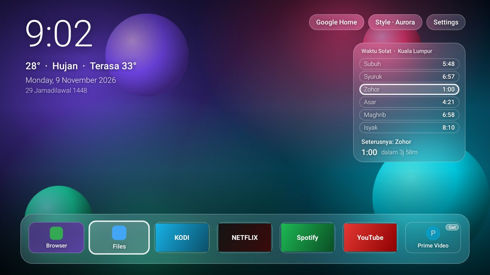

# Debloat Google TV

Make Android TV and Google TV boxes (Chromecast with Google TV, Google TV Streamer, Sony, TCL, Mi Box, Shield, etc.) **fast and smooth again**. It removes bloat, cuts background work, and swaps the ad-heavy home screen for a clean launcher.

Everything runs over ADB from your computer. You don't need root, and **every change can be undone**:

- Apps are removed only for the TV's user (`pm uninstall --user 0`). They stay on the system partition, and a factory reset brings them back.
- Before the first change, the script saves a backup of your packages, settings and home app.
- `./gtv.sh restore` puts the TV back the way it was.

> **Have an AI coding assistant?** Paste one line and let it do everything. See [PROMPT.md](PROMPT.md).

## Install from your phone (no computer needed)

You can do everything from an **Android phone** on the same Wi-Fi as the TV.

**1. Turn on debugging on the TV**

- Settings → System → About → click **Android TV OS build** 7 times. This turns on Developer options.
- Settings → System → Developer options:
  - **Google TV / Android 11 and newer:** turn on **Wireless debugging**.
  - **Older Android TV:** turn on **USB debugging** / **Network debugging**.

**2. Set up the phone (one time)**

- Install **Termux** from [F-Droid](https://f-droid.org/packages/com.termux/) or [GitHub](https://github.com/termux/termux-app/releases). The Play Store version is outdated and won't work.
- Open Termux and paste:

```bash
pkg install -y git && git clone https://github.com/haziqfikri96/Debloat-google-TV.git
cd Debloat-google-TV && bash setup-phone.sh
```

This installs `adb` and asks for access to your Downloads folder (tap **Allow**). It also adds a `gtv` shortcut.

**3. Run it:** type `gtv` and pick numbers from the menu:

```
Debloat Google TV   TV: not connected
  1) Connect to TV
  2) Pair TV (Google TV 12+ wireless debugging)
  3) Make it fast (backup + recommended debloat + speed tweaks)
  4) Debloat only (choose level)
  5) Speed tweaks only
  g) Glass home screen (frosted-glass launcher)
  w) Glass wallpaper from a photo
  p) Prayer times location
  h) Google Home control
  6) Other launcher (APK or package)
  7) Bring back stock home screen
  8) Status
  9) Undo everything
  r) Reboot TV
  0) Exit
```

- **Older TVs (Network debugging):** choose **1**, enter the TV's IP (Settings → Network), then accept *Allow debugging?* on the TV.
- **Google TV with Wireless debugging:** choose **2**. On the TV, open *Wireless debugging → Pair device with pairing code*. Enter the **IP:port and code** shown there. Then enter the **IP:port on the main Wireless debugging screen**. Note that the two ports are different.
- Then choose **3** to make the TV fast, and **r** to reboot.
- **Prayer times:** choose **p**, then type `gps` (uses the phone's location; needs the Termux:API app) or your town, e.g. `Shah Alam`. In Malaysia, the launcher uses JAKIM's official times for your zone.
- **Google Home:** choose **h** to set up the Google Home button (Assistant voice control or the TV's Home panel).
- **Glass look:** choose **g**. To frost your own photo, save it to the phone's Downloads folder, then choose **w**.
- **Another launcher:** download its APK in your phone's browser, then choose **6**. APKs in your Downloads folder are listed by number.

The TV address is remembered, so the next time you open `gtv`, you can go straight to any option.

> **Tip:** Termux on Android 12+ can get killed in the background. Keep Termux on screen while it works, especially during the "pre-compiling apps" step.
>
> **iPhone:** iOS can't run `adb`, so use a computer (below) instead.

## Install from an iPhone or iPad

iOS can't run Android, but the free **iSH Shell** app runs a small Linux on your iPhone/iPad. That Linux has Android's `adb` tool, which is all this toolkit needs. Nothing is installed on iOS itself.

1. **On the TV:** turn on debugging, as in step 1 above.
2. **On the iPhone/iPad:** install **[iSH Shell](https://apps.apple.com/app/ish-shell/id1436902243)** from the App Store, open it and paste:

   ```sh
   apk add git && git clone https://github.com/haziqfikri96/Debloat-google-TV.git
   cd Debloat-google-TV && sh setup-ios.sh
   ```

3. Type `gtv` and use the same menu as on Android (**1** connect / **2** pair, **3** make it fast, **g** Glass home screen, **p** prayer times, **h** Google Home).

Tips for iSH:
- **Allow Local Network:** when iOS asks whether iSH may find devices on your network, tap **Allow**. You can also turn it on later in Settings → Privacy & Security → Local Network → iSH. Without it, `gtv` can't reach the TV.
- **Keep iSH on screen.** iOS pauses background apps, so stay in iSH during "Make it fast", especially the app pre-compiling step.
- **Prayer location:** iSH can't read the iPhone's GPS, so type your town (e.g. `Shah Alam`) instead of `gps`.
- **Photos and APK files:** to use a wallpaper photo or APK from the Files app, run `mount -t ios . /mnt` in iSH and pick the folder (e.g. Downloads). `gtv` then finds files there by name.
- **Speed:** iSH emulates a PC processor, so commands run slower than on Android or a laptop, but every step works the same.

## Quick start (computer)

1. **On the TV:** Settings → System → About → click **Build** 7 times. Then Settings → System → Developer options → turn on **USB debugging** (on Google TV this also turns on network debugging).
2. **On your computer:** install [Android platform-tools](https://developer.android.com/tools/releases/platform-tools) so `adb` is on your PATH.
3. Find the TV's IP address (Settings → Network) and run:

```bash
git clone https://github.com/haziqfikri96/Debloat-google-TV.git
cd Debloat-google-TV

./gtv.sh -s 192.168.1.50 status          # connect; accept the prompt on the TV
./gtv.sh -s 192.168.1.50 -n all           # dry run: shows what would change
./gtv.sh -s 192.168.1.50 all              # backup + debloat + speed tweaks
./gtv.sh -s 192.168.1.50 reboot
```

> **Windows:** run it from **Git Bash** or **WSL**. **Mac:** macOS ships an old bash, so first run `brew install bash`, then use `$(brew --prefix)/bin/bash ./gtv.sh`.

## Commands

| Command | What it does |
|---|---|
| *(no command)* / `menu` | Numbered interactive menu, easiest on a phone |
| `connect <IP[:PORT]>` | Connects over Wi-Fi and remembers the TV for later runs |
| `pair <IP:PORT> <CODE>` | Pairs with *Wireless debugging* (Google TV / Android 11+) |
| `all [profile]` | Backup, debloat (default `recommended`), then speed tweaks |
| `debloat <profile>` | Removes the packages in a profile (see below) |
| `tweaks [0\|0.5\|1]` | Speed tweaks. The argument is the animation speed (default `0.5`; `0` turns animations off) |
| `glass` | **Redesign:** installs the frosted-glass home screen and sets it as home |
| `wallpaper <photo\|--remove>` | Puts your own photo behind the glass |
| `prayer <gps\|city\|lat,lng>` | Sets the prayer times location. Uses JAKIM's official times in Malaysia, calculated elsewhere, and checks the TV's clock and time zone |
| `google-home` | Sets up the Google Home button and restores Assistant/casting if they were debloated |
| `suggestions on\|off\|reset` | Icons for popular apps you haven't installed (installed only when you select them) |
| `apps` | Numbered list of the apps on your home screen. Type the numbers to remove (menu **u**) |
| `bring-back [pkg]` | Numbered list of apps `gtv` removed. Pick the ones to bring back (menu **b**) |
| `recheck` | Removes again any app that came back after a reboot or update (`status` shows them) |
| `screensaver on\|off` | Glass StandBy clock: a big clock, Hijri date and next prayer, burn-in safe |
| `launcher <apk\|package>` | Uses any other launcher instead |
| `launcher-reset` | Brings back the stock Google TV / Android TV home screen |
| `restore [backup]` | Undoes everything. By default it restores `original`, the state before your first run |
| `status` | Model, RAM, animation speeds, home app, bloat still installed, top memory users |
| `packages [filter]` | Lists installed packages, e.g. to find OEM bloat |
| `backup` / `backups` | Takes a snapshot / lists snapshots |

Once you `connect`, you don't need `-s` again. Options: `-s SERIAL|IP` picks the device, `-n` is a dry run, `-y` skips confirmation.

## Debloat profiles

Profiles stack: `aggressive` includes `recommended`, and `recommended` includes `safe`.

| Profile | Removes | You lose |
|---|---|---|
| `safe` | Tutorials, feedback, Play Games, YouTube Music/Kids/TV, print services, screensavers | Nothing important. Reinstall any app from the Play Store |
| `recommended` | **+** recommendation engine, Play Movies, partner promos, TalkBack, calendar/contact sync | Fewer "For you" rows |
| `aggressive` | **+** Google Assistant/voice search, offline speech, TTS, Chromecast built-in, Live Channels, Ambient mode (which also hosts the Google Home panel) | **Voice search, casting, and Google Home voice control**. `./gtv.sh google-home` restores the Assistant |
| `xiaomi` | Xiaomi tracking (`com.xiaomi.statistic`), promo auto-installer, Mi Music. Optional extras are listed in [`lists/xiaomi.txt`](lists/xiaomi.txt) | Nothing you'd notice. Use it on its own: `./gtv.sh debloat xiaomi` |
| `custom` | Whatever you put in [`lists/custom.txt`](lists/custom.txt) (OEM apps, unused streaming apps) | Your choice |

[`lists/protected.txt`](lists/protected.txt) lists packages the tool will **never** remove, even if you add them to a list: Play Services, Play Store, Settings, the keyboard, the setup wizard, the remote service and the stock launchers. Removing any of these can bootloop the TV or brick setup.

You can also pass a list file directly: `./gtv.sh debloat my-list.txt`.

## What `tweaks` changes

| Tweak | Why it helps |
|---|---|
| Animation scale 0.5× (or 0) | Menus and app switches feel twice as fast |
| Wi-Fi / Bluetooth "always scanning" off | Less background radio and CPU work |
| Screensaver / Ambient mode off | Stops the TV from downloading photos all day |
| `pm trim-caches` | Frees storage. Low storage makes Android TV crawl |
| ART `speed-profile` compile for all apps | Apps start and scroll faster. Takes a few minutes once |

## Redesign: frosted-glass home screen

Most of the lag on Google TV comes from the stock home screen. It is full of ads, autoplaying trailers and heavy recommendation rows. This repo includes **[Glass Launcher](glass-launcher/)**, a tiny home screen with a frosted-glass design that is built to stay smooth on cheap TV hardware.



```bash
./gtv.sh glass                    # install it and make it the home screen
./gtv.sh wallpaper beach.jpg      # optional: put your own photo behind the glass
./gtv.sh launcher-reset           # back to the stock home screen
```

It also has **prayer times** (JAKIM's official times in Malaysia), a **Google Home** button, and icons for popular apps that are **installed only when you select them**.

From the phone menu, choose **g** for the Glass home screen, **w** for a wallpaper, **p** for the prayer location and **h** for Google Home. The **Style** button on the TV switches between Aurora, Ocean, Sunset, Graphite and Photo. See [glass-launcher/README.md](glass-launcher/README.md) for how the glass stays fast.

### Or use another launcher

You can also install any other TV launcher APK, for example **Projectivy Launcher**, **FLauncher**, or **Wolf Launcher** / **ATV Launcher**:

```bash
./gtv.sh launcher ~/Downloads/launcher.apk   # install + set as home
./gtv.sh launcher com.spocky.projengmenu     # already installed from the Play Store
```

Either way, the script sets the new launcher as the home activity and **disables** (does not uninstall) the stock launcher. To undo it, run `./gtv.sh launcher-reset`.

> On some Chromecast / Google TV firmware, the HOME button is hard-wired to the stock launcher. If HOME still opens Google TV, use a launcher with an "override home button" accessibility option (Projectivy has one).

### Xiaomi TVs: Netflix / Prime Video come back after a reboot?

A hidden system app, `com.mstar.netflixobserver`, re-installs them at every boot, and it also runs the remote's Netflix button. `gtv status` shows apps that came back, and `gtv recheck` removes them again. To stop it for good, uncomment that line in [`lists/xiaomi.txt`](lists/xiaomi.txt) and run `gtv debloat xiaomi`.

## Undo / troubleshooting

- **Undo everything:** `./gtv.sh restore` then `./gtv.sh reboot`.
- **Reinstall a single app:** `adb shell cmd package install-existing <package>`
- **A feature broke:** check `./gtv.sh status`, then remove the related package from your list and run `restore`.
- **Worst case:** a factory reset restores every app, because nothing is deleted from the system partition.

Backups are stored in `backups/` (git-ignored). `original` always points to the state before your first change, and `latest` points to the newest snapshot.

## Credits

- Device knowledge (Xiaomi's Netflix observer, extra Xiaomi/Google tracking packages, which apps handle HDMI) is partly from the device lists of [CleanYourTV](https://github.com/Gathin23/cleanyourtv) (MIT) and [Glass TV](https://github.com/aqmangge/glass-tv-home).
- Official Malaysian prayer times come from [JAKIM e-Solat](https://www.e-solat.gov.my/).

## Disclaimer

Use at your own risk. Package names differ between manufacturers and firmware versions. Packages that aren't installed are skipped. Always try `-n` (dry run) first.
