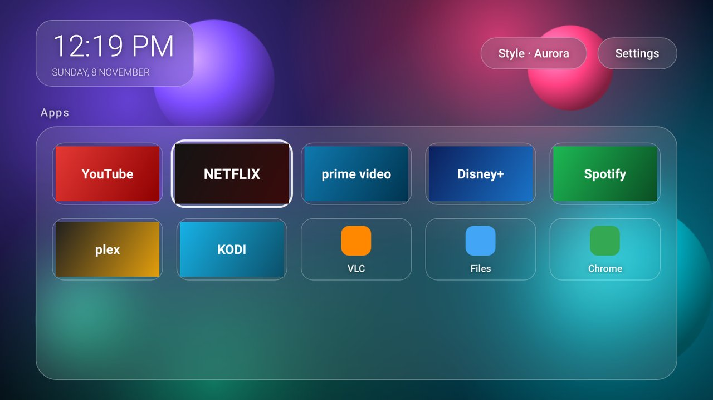
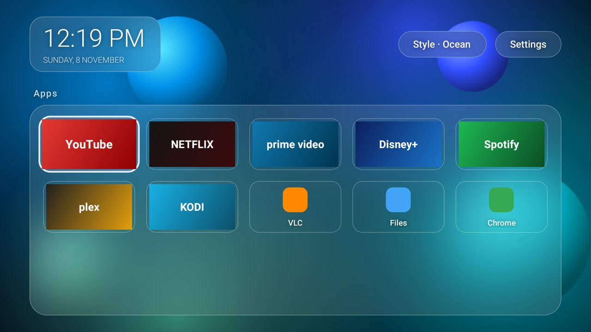

# Glass Launcher

A minimal, fast home screen for Android TV / Google TV with a **frosted-glass** look:
translucent cards, soft blur and bright glass edges over a colourful background.



| Ocean | Sunset | Your photo |
|---|---|---|
|  |  |  |

## Why it's smooth

- **The glass costs almost nothing per frame.** Real-time blur is heavy on TV chips. Instead, the background is blurred **once** into a tiny 160×90 bitmap. Each glass card draws the part of that bitmap that sits behind it: one GPU-scaled bitmap shader, a tint, a highlight and a rim.
- **No libraries.** The launcher uses only the Android framework (no AndroidX, Compose or Kotlin runtime). The APK is tiny and starts instantly.
- **No background work.** There are no ads, no recommendation rows and no autoplaying trailers. It has no network permission at all.
- **Focus animations are short (140 ms).** They only animate scale and alpha, which the GPU handles.

## Features

- All TV apps (their banners) and phone apps (icon and name), with the most used first
- Clock and date on a glass card
- **Style** button: Aurora, Ocean, Sunset, Graphite, or **Photo** (your own wallpaper)
- **Settings** button
- Long-press OK, or press MENU, on an app to open its App info (uninstall, clear cache, etc.)
- Press HOME while on the home screen to jump back to the first app

## Install

From the repo root, on a phone (Termux) or a PC:

```bash
./gtv.sh glass                      # downloads, installs and sets it as home
./gtv.sh wallpaper my-photo.jpg     # optional: frost your own photo
./gtv.sh launcher-reset             # go back to the stock home screen
```

Or use the `gtv` menu: **g** sets up the Glass home screen, and **w** sets a wallpaper.

## Build it yourself

GitHub Actions builds it on every change (`.github/workflows/glass-launcher.yml`). Builds from the default branch are published as `glass-launcher.apk` on the **glass-latest** release.

To build locally you need the Android SDK (API 34) and JDK 17+:

```bash
cd glass-launcher
gradle assembleRelease      # → app/build/outputs/apk/release/app-release.apk
```

`./gtv.sh glass` uses a local build automatically if one exists.
