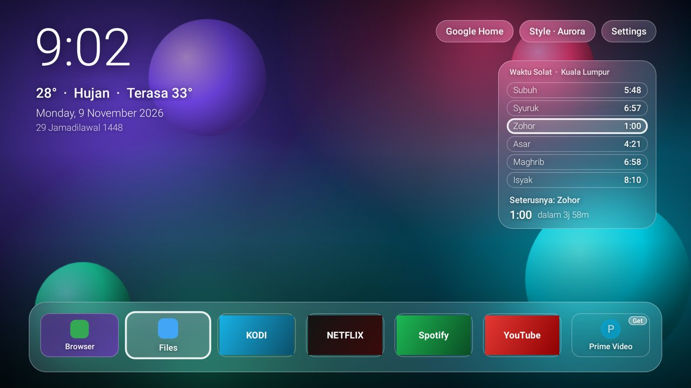
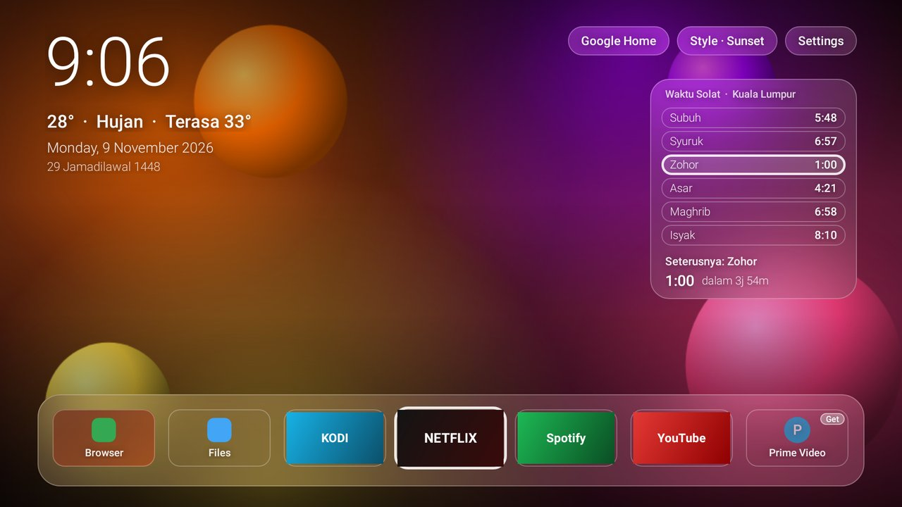
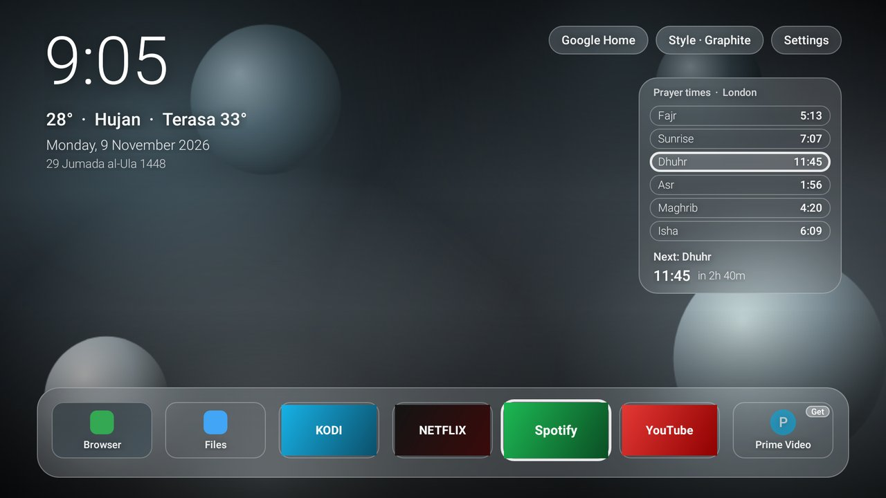
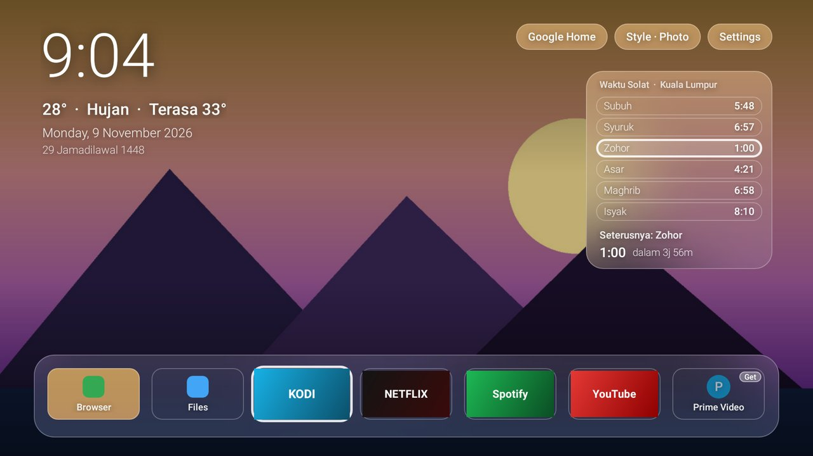

# Glass Launcher

A minimal, fast home screen for Android TV / Google TV with a **frosted-glass** look. It shows translucent cards, soft blur and bright glass edges over a colourful background. It also has accurate **prayer times**, a **Google Home** button, and icons for popular apps that **install only when you ask**.



Your wallpaper comes first: a big clock, the weather and the date float on the photo, next to a compact prayer card and a single glass dock of apps. The weather line ("28° · Hujan · Terasa 33°") comes from [Open-Meteo](https://open-meteo.com/) (free, no account) for your prayer location, and refreshes every 30 minutes.

| Sunset (Malaysia, JAKIM) | Graphite (London, MWL) | Your own photo |
|---|---|---|
|  |  |  |

## Prayer times

The prayer card shows today's six times, the next prayer with a countdown, the Hijri date, and where the times come from. When a prayer starts, the card shows *"It's time for …"* (*Waktu sekarang*) for 15 minutes.

| Where you are | Source of the times | How accurate |
|---|---|---|
| **Malaysia** | The **official JAKIM e-Solat timetable** for your zone. The zone is found from your location, the timetable is downloaded once a year and cached on the TV. | Identical to JAKIM / mosque times |
| Malaysia, offline | Calculation with JAKIM's method (Subuh 18°, Isyak 18°, ihtiyat fitted to the 2026 timetable) | Within 1 min of JAKIM on 96–100% of days in most zones |
| Everywhere else | Offline astronomical calculation with the local authority's method, chosen from the TV's time zone: MUIS, Kemenag, Umm al-Qura, Diyanet, ISNA, Egypt, Karachi, Tehran, Gulf, MWL… | Within 0.5 min of NOAA's solar calculations |

Malay names (Subuh, Syuruk, Zohor, Asar, Maghrib, Isyak) are used for Malaysia or a Malay/Indonesian TV language. Elsewhere it shows Fajr, Sunrise, Dhuhr, Asr, Maghrib, Isha.

**Set your location** from your phone with the `gtv` menu → **p**, or:

```bash
./gtv.sh prayer gps                       # this phone's GPS (needs the Termux:API app)
./gtv.sh prayer "Shah Alam"               # a town or city
./gtv.sh prayer 3.0738,101.5183           # exact coordinates
# options: --zone SGR01  --method muis  --asr hanafi  --lang en  --adjust fajr=+1,isha=-1
```

It also checks that the TV's clock and time zone are correct, because a wrong TV clock is the usual reason prayer times look "off".

## Apps

- Installed TV apps show their banners. Phone apps show an icon and name. The most used apps come first.
- **Popular apps you don't have** (YouTube, Netflix, Prime Video, Disney+, Spotify, YouTube Music, Plex, VLC) show as dimmed tiles with a **Get** badge. **Nothing is installed until you select one**, which opens its Play Store page. Apps you removed with debloat show their real icon.
- Long-press OK (or press MENU) on an app to open **App info**. On a suggestion, it **hides** the tile.
- `./gtv.sh suggestions off|on|reset` turns suggestions off or on, or brings back hidden ones.

## Inputs, Move and Hide

- **Inputs:** a glass **Inputs** button lists the TV's HDMI and AV inputs (PS5, set-top box…) and switches to one. It only appears on TVs that have inputs. Inputs are shown by the TV's own Live TV app, so if you removed it, bring it back with `gtv bring-back`.
- **Long-press OK** (or press MENU) on an app for a glass menu:
  - **Move:** the app wiggles. The arrows carry it, and OK puts it down. Your order is kept, and new apps join at the end.
  - **Hide from Home:** keeps an app installed but off your screen, which is handy for Settings-type tiles you can't uninstall. **Show hidden apps** brings them all back.
  - **App info.**

## StandBy clock

A screensaver with a big clock on black, the date and Hijri date, and the next prayer with a countdown. It works offline from the cached prayer timetable. It drifts a little every minute so nothing burns into the screen, and it turns dim red between 11 pm and 5 am. `gtv glass` turns it on, and `gtv screensaver off` turns it off.

## Google Home

The **Google Home** button opens the TV's Home panel when `./gtv.sh google-home` finds one. Otherwise it starts **Google Assistant**, so you can say *"turn off the living room lights"*.

`./gtv.sh google-home` also restores Assistant and Chromecast built-in if an aggressive debloat removed them.

You can also control your devices with the remote's mic button, or by long-pressing HOME on Google TV 12+. Long-press HOME opens Google TV's own Home panel, which is why `./gtv.sh glass` keeps the stock launcher enabled by default.

## HOME button on Google TV

Many Google TVs (Xiaomi, TCL, Chromecast) ignore the "default home app" setting. Glass handles this the same way Projectivy does: a small accessibility service, **Glass Launcher: open on HOME**, opens Glass whenever the Google TV home screen appears.

- It only watches which screen opens, and only for the stock launcher. It reads no content.
- `gtv glass` switches it on for you. If Projectivy's override is on, it asks before turning that off, so the two don't fight over HOME.
- The stock launcher stays enabled, so the Google Home panel keeps working.
- `gtv launcher-reset` puts your previous accessibility settings back, Projectivy included.

## Why it's smooth

- **The glass costs almost nothing per frame.** Real-time blur is heavy on TV chips. Instead, the background is blurred **once** into a tiny 160×90 bitmap. Each glass card draws the part of that bitmap that sits behind it: one GPU-scaled bitmap shader, a tint, a highlight and a rim.
- **No libraries.** The launcher uses only the Android framework (no AndroidX, Compose or Kotlin runtime). The APK is about 20 KB and starts instantly.
- **No background work.** There are no ads, recommendation rows or trailers. The network is used for one thing: the yearly JAKIM timetable (Malaysia only).
- **Focus animations are short (140 ms).** They only animate scale and alpha, which the GPU handles.

## Install

From the repo root, on a phone (Termux) or a PC:

```bash
./gtv.sh glass                      # install and set as home (keeps stock launcher for the Home panel)
./gtv.sh glass --replace            # also disable the stock launcher, if HOME ignores Glass
./gtv.sh wallpaper my-photo.jpg     # optional: frost your own photo
./gtv.sh launcher-reset             # go back to the stock home screen
```

## Build it yourself

GitHub Actions builds it on every change (`.github/workflows/glass-launcher.yml`). Builds from the default branch are published as `glass-launcher.apk` on the **glass-latest** release.

To build locally you need the Android SDK (API 34) and JDK 17+:

```bash
cd glass-launcher
gradle assembleRelease      # → app/build/outputs/apk/release/app-release.apk
```

## Credits

- Feature ideas (Inputs menu, Move/Hide, StandBy clock) from [Glass TV](https://github.com/aqmangge/glass-tv-home), built on [CleanYourTV](https://github.com/Gathin23/cleanyourtv) (MIT). No code was copied; Glass Launcher is written from scratch.

- Official Malaysian prayer times: [JAKIM e-Solat](https://www.e-solat.gov.my/)
- GPS → JAKIM zone lookup: [waktusolat.app](https://api.waktusolat.app/)
- Calculation: the [PrayTimes.org](http://praytimes.org/) algorithm
